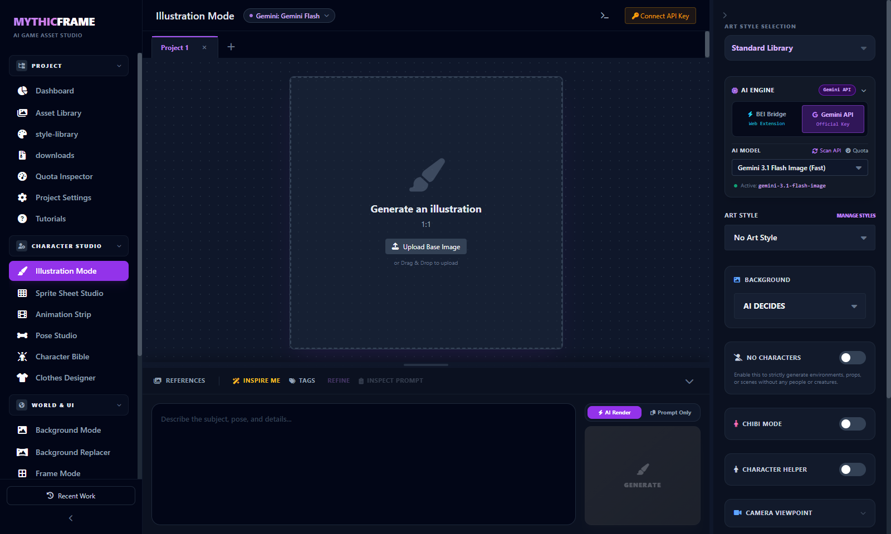

# MythicFrame

<div align="center">
  

  <h3>The Unified Open-Source 2D Game Asset Studio</h3>
  <p>Streamlined prompt engineering, character bible generation, sprite sheets, outpainting, outfit designer, and browser extension bridge.</p>

  <p>
    <a href="#core-philosophy">Philosophy</a> •
    <a href="#features">Features</a> •
    <a href="#quick-start">Quick Start</a> •
    <a href="#browser-extension-interface-bei">BEI Bridge</a> •
    <a href="#privacy--security">Privacy & Security</a> •
    <a href="#license--terms">License & Terms</a> •
    <a href="#legal-disclaimers">Legal Disclaimers</a>
  </p>
</div>

---

## Core Philosophy

MythicFrame is built for independent creators, hobbyists, and game developers who want a unified, friction-free creative workspace for 2D game asset generation.

### 1. Bring Your Own Account (BYOA) Unified Client
Much like an open-source email client (such as Thunderbird) or an RSS reader connects to your existing accounts, the Browser Extension Interface (BEI) functions as a single unified frontend client. It allows you to access and utilize the services and subscriptions you already legitimately own and pay for directly within your personal creative workspace.

### 2. Workflow Consolidation, Not Bot Automation
Rather than acting as a headless bot or unauthorized scraper, MythicFrame serves as an interactive workflow bridge. It eliminates tedious manual friction—copy-pasting prompts between tabs, downloading images, manually inspecting resolution, and organizing files—by piping your own interactive prompts and results straight to your studio canvas.

### 3. Local, Private, and Non-Commercial Open Source
Because MythicFrame runs entirely on your local machine with zero external middleware, tracking, ads, or monetization, your sessions and credentials remain strictly inside your personal browser. It exists purely to give creators a clean, unified interface to craft game assets using their own personal tools.

---

## Key Features

* **Character Bible & Gacha Canvas:** Generate multi-expression portraits, chibi sprites, and consistent character sheets with pose locking and identity anchors.
* **Clothes & Garment Designer:** Isolate garments, design new armor sets, and render transparent clothing assets directly on mannequin references.
* **Pixel Art Studio & Palette Shading:** Transform concepts into authentic retro game sprites across 8-bit, 16-bit, Game Boy, GBA, and Arcade color palettes.
* **Magic Resizer & Outpainting:** Pan, zoom, and expand canvases seamlessly to any game resolution or aspect ratio.
* **Background Replacer & Neo Matting:** Dual decontamination pipeline for clean edge extraction and green/white keying.
* **Sprite Sheet & Animation Timeline:** Generate directional keyframe animation sequences (idle, run, attack, cast) with onion skinning and GIF preview.
* **Batch Studio & CSV Automation:** Ingest structured CSV tables for high-volume automated card and asset production.
* **Account Priority Reordering & Auto-Failover:** Rank connected Google/ChatGPT accounts (`#1 Primary`, `#2 Fallback`), with automatic rotation when daily quotas or rate-limit cooldowns are reached.
* **Fake Active Anti-Throttling:** Spoofs `document.hidden`/`visibilityState` and streams inaudible audio buffers to prevent Chromium from throttling background generation tabs.
* **Zero-Quota Prompt Refinement & Inspiration:** Built-in AI prompt engineering assistant that refines prompts and synthesizes tailored game inspirations with zero image quota consumption.
* **Prompt Inspector & Universal Exporter:** Package fully assembled prompts and image references for Midjourney, ChatGPT, Stable Diffusion, or Pollinations with 1-click clipboard bundle export.
* **Model Context Protocol (MCP) Server:** Native MCP integration exposing automated asset generation tools directly to AI coding agents (Antigravity, Claude Code, Cursor).
* **Browser Extension Interface (BEI):** Native Chrome extension bridge to authenticated Gemini Web and ChatGPT Web sessions for zero-key local operation.

---

## Complete Documentation Index

| Guide | Description |
| :--- | :--- |
| **[Master Project Reference](docs/MythicFrame_PROJECT_DOCUMENTATION.md)** | Full specification covering all 15+ studios, persistence, and specialized algorithms. |
| **[BEI Mode Architecture](docs/BEI_MODE.md)** | Deep-dive on Zero-API-Key BYOA bridge, account slots, anti-throttling, and quota rotation. |
| **[BEI Installation & Automation Guide](bei-extension/INSTALLATION_AND_USAGE_GUIDE.md)** | Step-by-step setup guide for humans + programmatic REST & WebSocket API reference for AI agents. |
| **[BEI Extension Readme](bei-extension/README.md)** | Fast 30-second Chrome load-unpacked guide and port specifications. |

---

## Quick Start

### Prerequisites
* [Node.js](https://nodejs.org/) (v18 or higher recommended)
* [Google Chrome](https://www.google.com/chrome/) (optional, for BEI browser extension mode)

### 1. Installation
```bash
git clone https://github.com/VioleGracex/mythicframe.git
cd mythicframe
npm install
```

### 2. Run Locally
```bash
# Starts both the Vite frontend studio and the BEI local bridge server
npm run dev
```

Open your browser at **`http://localhost:3488`**.

---

## Browser Extension Interface (BEI)

The BEI Chrome Extension is a client-side assistive helper connecting your open browser tab to the local studio canvas with **Zero API Keys**:

1. Open Chrome and navigate to `chrome://extensions/`.
2. Toggle on **Developer mode** (top right).
3. Click **Load unpacked** (top left) and select the `bei-extension` folder inside this repository.
4. Keep a Gemini Web (`gemini.google.com`) or ChatGPT Web (`chatgpt.com`) tab open.
5. In MythicFrame Studio, select **Browser Bridge (BEI)** in the AI Engine Selector.
6. Generate artwork directly onto your canvas with automatic high-res capture.

### Advanced BEI Mechanics
* **Account Priority & Reordering:** In **Settings -> BEI Mode**, use up and down reordering controls to set account priority (`#1 Primary`, `#2 Fallback`).
* **Automatic Quota Failover:** With `Auto-Failover on Quota Limit` enabled, if your active account reaches a daily limit or rate-limit cooldown, MythicFrame automatically rotates to the next priority account without interrupting your workflow.
* **Auto-Sort by Available Quota:** 1-click button to rank accounts with ready quota at the top and push cooldown accounts to the bottom.
* **Fake Active Anti-Throttling Mode:** Prevents Chrome from throttling background generation tabs during long prompt executions.
* **Dedicated Window Grouping:** Isolates generation tabs into a designated Chrome window with a purple `"MythicFrame BEI"` tab group to eliminate workspace clutter.
* **High-Res CDN Harvester:** Automatically rewrites Google CDN parameters (`=s1024` -> `=s0` / `=s2048`) to extract uncompressed full-fidelity assets.

> For full technical details and automation instructions, see [`bei-extension/INSTALLATION_AND_USAGE_GUIDE.md`](./bei-extension/INSTALLATION_AND_USAGE_GUIDE.md) and [`docs/BEI_MODE.md`](./docs/BEI_MODE.md).

---

## Privacy & Security

* **100% Local Execution:** The application, bridge server, and extension execute strictly on `127.0.0.1` on your machine.
* **Zero Credential Transmission:** No passwords, cookies, or session tokens are ever extracted, intercepted, or transmitted over any network. All authentication lives exclusively inside your standard browser session.
* **Manual Stop Interception:** Detects user clicks on browser "Stop response" buttons instantly, aborting generation gracefully with zero quota impact.
* **Optional Official API Mode:** If you prefer direct developer API keys, you can provide your own Gemini or OpenAI API key in **Settings**, stored strictly in your browser's private `localStorage`.

---

## License & Terms

MythicFrame is released as open-source software under the **[PolyForm Noncommercial License 1.0.0](LICENSE)**.

### Allowed (Non-Commercial):
* Personal hobbyist projects, non-commercial indie game development, and game jams.
* Educational, classroom, and academic learning/research.
* Open-source contributions, auditing, and enhancements under the same license terms.

### Prohibited (Commercial):
* Selling, sublicensing, or charging fees for this software.
* Hosting or operating this software as a paid cloud service, SaaS, or remote API endpoint.
* Bundling or embedding this software into proprietary, monetized, or commercial products.

For complete terms and rules, read [LICENSE](LICENSE) and [TERMS_OF_USE.md](TERMS_OF_USE.md).

---

## Legal Disclaimers

* **Independent Project:** MythicFrame is an independent community project. It is **not** affiliated with, endorsed by, certified by, or sponsored by Google LLC, Alphabet Inc., OpenAI Inc., or any of their affiliates.
* **Trademarks:** Google, Gemini, Imagen, and Google Cloud are trademarks or registered trademarks of Google LLC. OpenAI, ChatGPT, and DALL-E are trademarks or registered trademarks of OpenAI, Inc. All other product names, logos, and brands are property of their respective owners.
* **User Responsibility:** Users who connect third-party web services or API keys are solely responsible for ensuring that their usage complies with all applicable Terms of Service, Acceptable Use Policies, and rate limits of those third parties.
* **No Warranty:** This software is provided "AS IS", without warranty of any kind, express or implied. The authors and contributors bear no liability for any direct, indirect, or consequential damages resulting from the use of this software.
